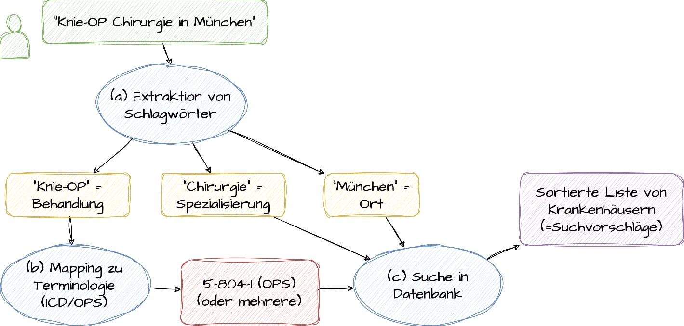

# Klinikatlas Search

## Getting started

This project is set up with uv and uses Marimo Notebooks. To start them, use

`uv run marimo edit`

Ein Prototyp der Suche nach ICD- und OPS-Codes kann getestet werden. Der Code dazu liegt in [src/prototype.py](src/prototype.py).

## Vision

